# WUI-MF — Wildland Urban Interface Mitigation Framework

A mobile-first Progressive Web App for assessing wildfire risk on a property.
Built to work **offline in the field** and sync back to Supabase when a
connection returns.

> 🌐 **Live system:** [firerisk.janusresearchgroup.workers.dev](https://firerisk.janusresearchgroup.workers.dev)
> — hosted on Cloudflare Workers (static assets); deployed with `npm run deploy`.

- **Stack:** Vite · React 18 · TypeScript
- **Mapping:** Mapbox GL
- **On-device CV:** onnxruntime-web (WUI hazard detector) + TensorFlow.js (DeepLab segmentation)
- **AR viewer:** Three.js / WebXR
- **Offline store:** Dexie (IndexedDB) with a sync queue
- **Backend:** Supabase (auth, Postgres + row-level security, Storage)

**What it does:**
- **Homeowners** assess a property against their state's wildfire guidelines,
  get prioritized recommendations, and track mitigation progress with notes
  and photo evidence.
- **Fire agencies** review submitted assessments on a dashboard, and their
  inspectors verify completed work. They export grant-reporting data and check
  properties against current-year wildfire perimeters.

This implements capability C5-2 of the
[WFCA Phase 2 report](https://wfca.com/wp-content/uploads/2026/06/Phase-2-Report_National-Wildland-Fire-Tech-Summit_Operational-Capabilities.pdf),
"Nationwide Integrated Mitigation Tracking"; see
[Mitigation tracking & the agency workflow](#mitigation-tracking--the-agency-workflow).

> 📖 **New here?** See the [**User Guide**](docs/USER_GUIDE.md) — an illustrated,
> step-by-step walkthrough of how to use the app, from signing in to completing
> and sharing an assessment.

## Getting started

```bash
npm install
cp .env.example .env   # then fill in the values below
npm run dev            # Vite dev server
```

### Environment variables

| Variable                 | Purpose                          |
| ------------------------ | -------------------------------- |
| `VITE_SUPABASE_URL`      | Supabase project URL             |
| `VITE_SUPABASE_ANON_KEY` | Supabase anon/public key         |
| `VITE_MAPBOX_TOKEN`      | Mapbox GL access token           |

`supabaseClient.ts` falls back to placeholder values if the Supabase vars are
missing, so the app boots for local UI work — but Supabase calls will fail. The
map shows a configuration prompt if `VITE_MAPBOX_TOKEN` is unset.

## Commands

```bash
npm run dev        # Vite dev server
npm run build      # tsc (typecheck) then vite build
npm run preview    # serve the production build
npm run lint       # eslint (max-warnings 0)
npm run test       # vitest
npm run test:e2e   # playwright
npm run deploy     # build + wrangler deploy to Cloudflare Workers (firerisk)

npm run export:training   # pull training-consented photos into a YOLO dataset
npm run import:consented  # fold exported consented photos into the labeling pool
npm run flywheel          # export:training + import:consented (run on a schedule)
npm run label:prepare     # build a SAM-assisted labeling bundle
npm run import:photos     # import local photos
npm run eval:detector     # golden-image evaluation of the WUI hazard detector
npm run sync:ort          # re-copy the onnxruntime-web runtime into public/ort/

supabase/tests/run-rls-tests.sh   # database security tests (needs Docker running)
```

Run a single test file: `npm run test -- path/to/file.test.ts`.
Run a single test by name: `npm run test -- -t "test name"`.

The **RLS test runner** applies every migration in `supabase/migrations/` to a
throwaway Postgres container, then runs each `supabase/tests/*_rls.sql` file in
its own fresh copy of that database. Each check prints `PASS`/`FAIL`, and the
script exits non-zero on any failure. The stub (`supabase_stub.sql`) mirrors
Supabase's `auth`/`storage` schemas and its default grants, including the one
that gives `anon` EXECUTE on new functions.

## Architecture

- `src/app/` — root `App.tsx` (router + provider tree) and `providers/`
  (auth, offline, theme).
- `src/features/<feature>/` — feature modules, each owning its `components/`,
  `hooks/`, and sometimes `services/`. Lazy-loaded from `App.tsx` for code
  splitting.
- `src/shared/` — cross-feature `components/`, `services/` (Supabase client,
  Dexie offline storage), `stores/` (Zustand), and `types/`.

Path aliases: `@/*` → `src/*`, plus `@features/*`, `@shared/*`, `@lib/*`.

**Offline-first:** Dexie is the source of truth while offline. Writes go through
`saveXLocally()` / `updateXLocally()` helpers that update Dexie and enqueue a
sync operation; `OfflineProvider` flushes the queue when the network returns.
Photos are stored as Blobs locally and uploaded to Supabase Storage on sync.

## State-localized inspection guidelines

The inspection checklist follows the property's **US state**. During an
assessment the app resolves the state fully offline — GPS coordinates are
matched against bundled state boundaries, falling back to parsing the typed
address — and selects that state's guideline profile from
`src/features/assessment/content/guidelines/`. States with a wildfire code or
their own published guidance (**24 as of Aug 2026** — e.g. California's
PRC 4291/Zone 0, Colorado's Wildfire Resiliency Code, Utah's WUI Code) get
state-specific checklist items, distances, and recommendations; everywhere
else uses a **national composite** baseline (NFPA Firewise + IBHS).

The checklist shows which guideline set is in use, its legal standing (state
law / partly state law / state guidance / national baseline), and links to
the official sources; the profile used is stored on the assessment
(`guidelineProfileId`) so saved and shared reports keep their provenance.

> 📋 See [**docs/INSPECTION_GUIDELINES.md**](docs/INSPECTION_GUIDELINES.md)
> for a state-by-state record of exactly which guidelines were used to
> determine the inspection parameters, with sources.

## Risk scoring

An assessment is scored across **six categories**, each on a **0–10** integer
scale, from a weighted Yes/No inspection checklist in the assessment wizard
(`ChecklistStep.tsx`). The items come from the property's resolved guideline
profile (see above), so the exact questions and weights vary by state — the
scoring math below is the same for every profile.

> **Higher score = safer.** The scale measures preparedness/mitigation, so a
> high score means *lower* wildfire risk.

### Category score

Every checklist item belongs to one category and carries an integer `weight`.
For each category, `calculateScores()` computes:

```
categoryScore = round( (Σ weight of items answered "Yes") / (Σ weight of ALL items in the category) × 10 )
```

Key details:

- Only a **"Yes"** earns that item's weight. A **"No"** *and an unanswered
  item* both contribute 0 — the denominator always includes every item in the
  category, so skipping questions lowers the score exactly like a "No".
- The result is rounded to the nearest integer in **0–10**.

Item counts and weights are per-profile. The **national composite** profile
has **21 items** across the six categories, with these maximum weighted
points (the denominator per category); state profiles add, replace, or
re-weight items but every profile must cover all six categories
(test-enforced — a missing category would zero its score):

| Category (checklist key)          | Items | Max weight | Highest-weighted items (weight 3) |
| --------------------------------- | ----- | ---------- | --------------------------------- |
| Defensible space (`defensible-space`) | 5 | 11 | Zone 0 cleared to bare soil/hardscape |
| Roof & structure (`roof-structure`)   | 5 | 10 | Class A fire-rated roof |
| Vegetation management (`vegetation`)  | 3 | 6  | — (all weight 2) |
| Ember intrusion (`ember-intrusion`)   | 3 | 7  | WUI-rated ember/flame-resistant vents |
| Access & evacuation (`access-evacuation`) | 3 | 5 | — (max weight 2) |
| Water supply (`water-supply`)         | 2 | 3  | — (max weight 2) |

Each checklist item also carries an optional `standard` provenance tag
(e.g. `CAL FIRE PRC 4291`, `CWUIC`, `IBHS WFPH`) shown in the UI, and each
profile declares its legal basis and official source links.

### Overall score

The **overall score** is the **unweighted average of the six category scores**,
rounded to one decimal place (`calculateOverallScore` in `AssessmentWizard.tsx`)
— note the categories themselves are *not* re-weighted against each other. It
maps to a risk level:

| Overall score | Risk level |
| ------------- | ---------- |
| ≥ 8           | Low        |
| ≥ 6           | Moderate   |
| ≥ 4           | High       |
| < 4           | Extreme    |

Risk levels drive the `risk-{low,moderate,high,extreme}` Tailwind colors and
`.risk-badge-*` classes, and color the property markers on the Risk Map
(thresholds are in `getRiskLevel`, `AssessmentDetail.tsx`).

## Mitigation tracking & the agency workflow

Built to the WFCA Phase 2 MO-5 capability **C5-2**: "Nationwide Integrated
Mitigation Tracking and Community Resilience Common Operating Portal". The
flow:

```
Homeowner                         Agency (inspector / admin / viewer)
─────────                         ────────────────────────────────────
assess → recommendations
track each: To do → Planned →
  In progress → Done (+ notes,
  evidence photos)
Share → Agency: submit ─────────▶ Inspections dashboard (rollups, map, list)
                                  open the report (read-only)
                                  Verify a Done item (+ note) ──┐
"Verified by <agency>" ◀────────────────────────────────────────┘
                                  review status: New → In review → Closed
                                  exports (CSV / GeoJSON / PDF)
                                  fire-exposure check (NIFC perimeters)
```

### Mitigation tracking (homeowner)

The report's Recommendations section tracks each recommendation:
`planned → in_progress → completed`, with notes and evidence photos, a
progress bar, and a count of open *immediate* items.
- **Storage:** offline-first, one record per (assessment, recommendation) in
  Dexie `mitigationActions` and the `mitigation_actions` table.
- **Ids are deterministic** (uuid v5), so two devices converge on one row.
- **`verified` is third-party only.** The database rejects an owner setting it
  and locks the row once it's verified. When a verification arrives from the
  server, it replaces the owner's local copy.

### Organizations, roles & inspector verification

- **Organizations** are fire agencies, local governments, state agencies,
  insurers or NGOs. Their names are public.
- **Members** have one of three roles:
  - `admin` and `inspector` can verify;
  - `viewer` can only read.
- **Memberships are provisioned server-side**; there is no self-serve way to
  become an inspector. Run this in the Supabase SQL editor:

  ```sql
  insert into public.organizations (name, kind, state_code)
    values ('Boise Fire Department', 'fire_agency', 'ID') returning id;
  insert into public.organization_members (organization_id, user_id, role)
    select '<org id>', id, 'inspector' from auth.users where email = 'inspector@example.gov';
  ```

- **Submitting:** a homeowner submits an assessment to an organization (Share
  → Agency). Members of that organization can then **read** it.
- **Not public:** a submission does not make the report public. Agency
  submissions are separate from share links.
- **Withdrawing** a submission removes the organization's access.
- **Verifying** happens only through the `verify_mitigation_action()` and
  `revoke_mitigation_verification()` database functions. They check:
  - the caller's role, and that the assessment was submitted to their
    organization;
  - that the item is Done;
  - that the inspector isn't verifying their own property (conflict of
    interest).

  The server stamps who verified, for which organization, when, and the note.
  Only the verifying organization can revoke.

### Agency dashboard (`/inspections`)

Shown only to organization members (`AgencyDashboard.tsx`):
- **Rollup tiles:** properties, % of mitigations done, verified, awaiting
  verification, and immediate items outstanding.
- **Map** of submitted properties, colored by progress: red not started,
  amber under way, blue all done, green all verified. These are property
  points; there's no parcel geometry yet.
- **List** filterable by progress and review status. Inspectors and admins move
  a submission **New → In review → Closed** (`set_submission_status()`).
- **Data source:** `agency_dashboard(org)`. It runs with the caller's
  permissions, so row-level security decides what each person sees. Its counts
  cover only each assessment's *current* recommendations.

### Reports & exports

- **PDF:** **Print / Save as PDF** on any report (owner, inspector,
  share-link) and on the dashboard. This is the browser's print dialog, with no
  PDF library, and it works offline.
  - `printPage()` loads lazy photos first and prints in the light theme.
  - Tailwind `print:` variants hide the app chrome and controls.
- **Dashboard exports** always cover every submission, not the on-screen
  filters:
  - **Properties (CSV):** one row per property, with progress counts.
  - **Mitigation actions (CSV):** one row per recommendation, with status,
    completed and verified dates, the verifying organization and its note.
  - **Map points (GeoJSON):** RFC 7946, for ArcGIS or QGIS.
  - **Exposures (CSV):** see below.
- **CSV format:** RFC 4180 with a UTF-8 BOM. Text cells that a spreadsheet
  would run as a formula are neutralised (CSV injection), because addresses and
  notes are user-entered.

### Fire exposure (effectiveness monitoring)

The dashboard's **Fire exposure** card answers WFCA's KSA-7 requirement,
"automatic intersection with fire events for evaluation".
- **The check:** an inspector or admin runs **Check against fire perimeters**.
  For each located property, the browser asks NIFC's **WFIGS Interagency
  Perimeters (Year to Date)** service which wildfires contain it or lie within
  1 km. Prescribed burns are excluded.
- **Recording:** each hit is saved through `record_fire_exposure()` with a
  snapshot of the property's mitigation **as of the fire's discovery date**:
  - **verified at start:** server-stamped, so trustworthy;
  - **done at start:** the owner's completion dates, so self-reported.
- **No backdating:** the snapshot is written once, so marking items done after
  a fire can't improve the record. Re-detection only upgrades "near" to
  "inside".
- **Why it's stored:** the year-to-date service resets every January.

## Security model

All data access is enforced in Postgres with row-level security, not in the
client. Highlights:

- **Owners** read and write only their own properties, assessments, photos,
  annotations and mitigation actions.
- **Share links** (`/report/:token`) are bound to their token.
  - The shared view sends the token in an `x-share-token` header, and
    `assessment_is_shared()` only matches that token's share.
  - Share rows can't be listed, and shared assessments can't be enumerated
    without a token.
- **Reviewers** (organization members) can only **read** assessments
  submitted to their organization. All their writes go through security-definer
  functions that check role and context.
- **Photo storage:** only the assessment's owner can write under
  `<assessmentId>/` in the `assessment-photos` bucket. Listing is limited to the
  owner and reviewers. The bucket is still *public*, so anyone with a photo's
  exact URL can open it; making it private needs signed URLs and is an open
  item.
- **Functions:** new public functions revoke EXECUTE from `anon` explicitly,
  because Supabase grants it by default.

Every rule above has PASS/FAIL tests in `supabase/tests/`.

## Database migrations & rollout

Migrations live in `supabase/migrations/` and are applied in filename order in
the Supabase SQL editor (no CLI is set up). The C5 and security work added:

| Migration | Adds |
| --- | --- |
| `20261009100000_mitigation_actions` | Mitigation tracking table, owner RLS, usage-view counts |
| `20261012100000_organizations_inspector_verification` | Organizations, members, submissions, reviewer read policies, verify/revoke functions |
| `20261012110000_share_token_bound_reads` | Token-bound share-link reads (security fix) |
| `20261012120000_photo_storage_owner_scoped` | Owner-only photo writes, owner/reviewer listing (security fix) |
| `20261012130000_verification_functions_revoke_anon` | Removes anon EXECUTE on verify/revoke |
| `20261012140000_agency_dashboard` | `agency_dashboard()`, `set_submission_status()` |
| `20261013100000_agency_mitigation_export` | `agency_mitigation_export()` |
| `20261013110000_fire_exposures` | `fire_exposures` table, `record_fire_exposure()` |

**Rollout order:**
- **Additive migrations** (new tables and functions): apply the SQL first, then
  deploy the app.
- **Migrations that change existing behavior** (the share-link fix): deploy the
  app first, so the client is ready, then apply the SQL.

## Risk Map data layers

The Risk Map (`src/features/maps/`) supports four toggleable layers, each backed
by a live, public, no-cost data source (only the Mapbox token is required):

| Layer               | Source                                   | Coverage | How it's consumed |
| ------------------- | ---------------------------------------- | -------- | ----------------- |
| **Fire History**    | CAL FIRE (FRAP) in CA + NIFC InterAgencyFirePerimeterHistory nationally, ArcGIS FeatureServers | US | Viewport bbox query (`f=geojson`), refetched on pan/zoom → GeoJSON source |
| **Vegetation/Fuel** | LANDFIRE Scott & Burgan 40 fuel models (USGS/USFS WMS) | CONUS    | WMS `GetMap` raster tiles (EPSG:3857) |
| **Slope Analysis**  | USGS 3DEP elevation, "Slope Map" rendering rule (ArcGIS ImageServer) | CONUS (+HI/territories) | `exportImage` raster tiles (EPSG:3857) |
| **Defensible Space**| Building footprint buffered 5 / 30 / 100 ft (per CAL FIRE PRC 4291); circle fallback | US | `@turf/buffer` over the Mapbox building footprint → GeoJSON |

Notes:
- **Fire History is hybrid**: the source is chosen per viewport — CAL FIRE
  (FRAP) when the whole view sits inside California (most CA-current data),
  otherwise NIFC's national history. NIFC already includes CalFire data, so a
  border-straddling view still shows CA fires (from NIFC) with no duplicate
  perimeters. Both are bbox-limited and only fetch at zoom ≥ 7 (2000-record
  cap). Field mapping differs per source (`FIRE_NAME`/`YEAR_` vs
  `INCIDENT`/`FIRE_YEAR_INT`), normalized to `name`/`year`/`acres`.
- The raster overlays (Vegetation, Slope) request Web Mercator tiles via
  Mapbox's `{bbox-epsg-3857}` token and sit beneath base-map labels so the
  vector overlays stay on top.
- All layer fetches are visibility-gated (no network when a layer is off) and
  fail gracefully offline, keeping whatever is already drawn.
- **Defensible Space** is drawn around a *focused* property — tap a property
  marker, use the Locate button, select a property (below), or open the map
  from an assessment. When the layer is on but nothing is focused yet, it falls
  back to the user's GPS location (or map center if location is denied), so
  toggling it always shows something. Circles draw instantly, then — once the
  map settles at zoom 17 — the zones **upgrade to the building's outline**: the
  Mapbox building footprint under the point is buffered outward 5 / 30 / 100 ft
  (`@turf/buffer`). Where no footprint exists (rural areas, low zoom, missing
  map data) the circles remain. The rings are a real 100 ft buffer, so they
  look small until you zoom in. The zone geometry lives in
  `src/shared/utils/defensibleZones.ts` and is **shared with the AR view** — see
  [Augmented reality](#augmented-reality).
- **Legend**: a per-layer key (`MapLegend`) shows one card per *visible* layer,
  bottom-left — a layer's key appears only while that layer is on. The
  Vegetation key is representative (LANDFIRE FBFM40 has 40 classes).
- **Location on iOS**: WebKit only shows the geolocation prompt for a
  gesture-initiated request, so the map auto-attempt on load is silently
  ignored there. Tap the **Locate** button or the **Enable location** banner
  (mirrors the AR view's "Enable AR positioning" tap) to trigger the prompt.

### Legend keys

A per-layer key shows in the bottom-left, one card per *visible* layer (colors
mirror each layer's rendering):

<p>
  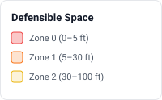
  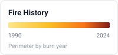
  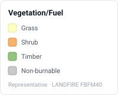
  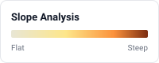
</p>

### Selecting a property

The **Select a property** button (🔍 in the map control stack) opens a modal
with two ways to choose a location:

- **Search by address** — geocoded with the **Mapbox Geocoding API**
  (`geocoding/v5`), biased to the US and to the current map center (`proximity`).
- **Pick on the map** — tap to drop the point (crosshair cursor + cancel hint).

The chosen point is pinned (labeled with the resolved address) and focused —
the map flies to zoom 17 and draws its defensible-space zones — with a **Clear**
option. Geocoding reuses the existing `VITE_MAPBOX_TOKEN`; no extra config.

### Mitigation icon palette

When the map is opened from an assessment (`/map/:assessmentId`), a horizontal
icon palette appears at the bottom — a quick-place mode carried over from the
original BFMA Unity app. Tap an icon to arm it, then every map tap drops that
icon; tap the icon again to stop. The **?** button on the strip opens this same
legend in-app. Placed icons are stored as `mitigation-icon` annotations through
the same offline-first sync pipeline as other markers, appear live in the AR
view, and fire a `map_icon_placed` analytics event.

**The artwork is BFMA's original NAPSG-style map symbology** — the 35 PNGs in
`public/icons/mitigation/` are copied from the Unity project
(`bfma_gold/Assets/Art/2D/MitigationIcons/_Round/`), so markers placed here
read identically to the shipped mobile app. Round symbols mark property/HIZ
items; diamond symbols mark parcel-level responder risks. The catalog —
labels, categories, and usage guidance — is defined in
`src/shared/utils/mitigationIcons.ts` (single source of truth for the palette,
the markers, the in-app legend, and this table). Zone terminology matches the
inspection guidelines: Zone 0 is the 0–5 ft ember-resistant zone, Zone 1 is
5–30 ft, Zone 2 is 30–100 ft.

#### Debris

| Icon | Name | When to place it |
| --- | --- | --- |
|  | **Debris** | General combustible debris accumulations not covered by a more specific icon. |
|  | **Debris — foundation/deck** | Leaf litter, mulch, firewood, or stored items against the foundation, walls, or deck. The 0–5 ft zone should be bare soil or noncombustible hardscape. |
|  | **Debris — roof/gutter** | Leaves, needles, or branches on the roof, in gutters, or in roof valleys — wind-blown embers ignite this debris first. |

#### Vegetation & fuels

| Icon | Name | When to place it |
| --- | --- | --- |
|  | **Fire ladder — trim** | Trees whose lower limbs should be removed (limb up 6–10 ft) so ground fire cannot climb into the crown. |
|  | **Fire ladder — vegetation** | Shrubs or small trees beneath a larger canopy; this understory carries ground fire into the crowns. |
| 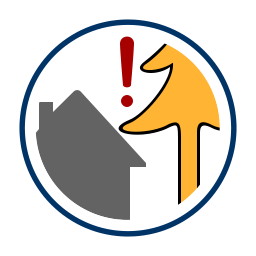 | **Vegetation overhang** | Branches overhanging the roofline, deck, or chimney — keep ~10 ft of clearance. |
|  | **Vegetation underhang** | Vegetation under eaves, overhangs, or sheltered walls where embers collect. |
|  | **Vegetation spacing** | Zone 1 shrubs or canopies too close together — keep ~10 ft between canopies, more on slopes. |
| 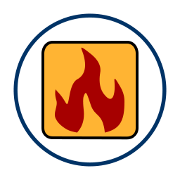 | **Fuel packet** | A dense, continuous pocket of fuels that can carry fire toward the structure. |
| 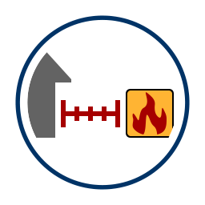 | **Proximity to fuel source** | Structure close to a major fuel source — woodpile, brush field, dense adjacent vegetation. |
| 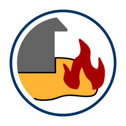 | **Bedding materials** | Combustible mulch in planting beds near the structure — replace with gravel in the 0–5 ft zone. |

#### Structure & hardening

| Icon | Name | When to place it |
| --- | --- | --- |
|  | **Structure** | The primary structure the assessment is anchored to. |
|  | **Secondary structure** | Sheds/outbuildings within the HIZ — each needs its own clearance. |
|  | **Structural repairs needed** | Damaged roofing, siding, soffits, or trim leaving ember entry gaps. |
|  | **Roofing material** | Combustible roof covering (e.g. wood shake) — Class A is the biggest hardening upgrade. |
|  | **Siding material(s)** | Combustible siding, especially near grade. |
| 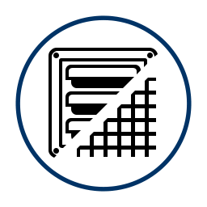 | **Vents/Screens** | Vents without intact 1/8-inch metal mesh — a primary ember entry path. |
|  | **Attached fencing** | A wooden fence meeting the house acts as a fuse — replace the final 5 ft with a noncombustible section. |
| 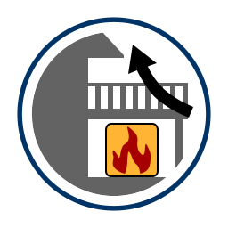 | **Deck — storage under** | Items stored under a deck or porch; decks need a clear 0–5 ft noncombustible zone. |
| 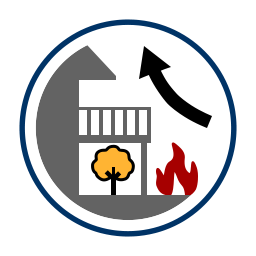 | **Deck — vegetation under** | Vegetation growing beneath a deck or porch — embers collect in these pockets. |
| 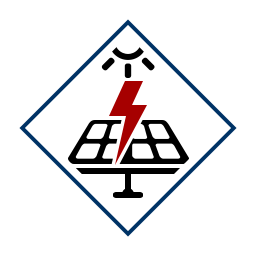 | **Solar/electrical risk** | Solar arrays, batteries, or electrical equipment responders should know about. |

#### Access & water supply

| Icon | Name | When to place it |
| --- | --- | --- |
| 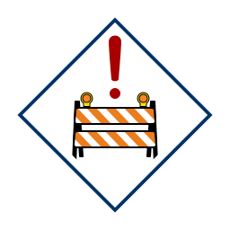 | **Parcel access risk** | Overall difficult apparatus access — gates, grade, surface, clearance. |
|  | **Road width** | Road too narrow for apparatus plus evacuation traffic. |
| 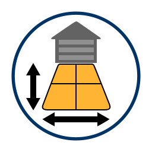 | **Driveway length/width** | Long, narrow, or overgrown driveway limiting engine access. |
|  | **Adequate turnaround** | A usable apparatus turnaround — mark it for responders. |
| 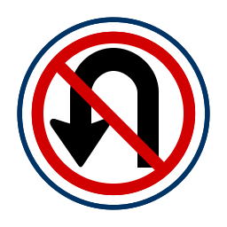 | **Inadequate turnaround** | No way for apparatus to turn around — a dead-end approach. |
| 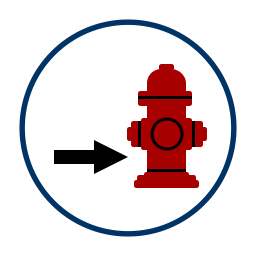 | **Distance to hydrant** | The nearest hydrant or drafting source, to record water-supply distance. |
| 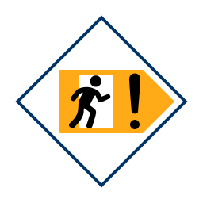 | **Poor escape risk** | Limited evacuation egress — a single way out or routes through heavy fuels. |

#### Responder hazards

| Icon | Name | When to place it |
| --- | --- | --- |
|  | **Hazmat risk** | Stored hazardous materials — fuels, chemicals, pesticides. |
| 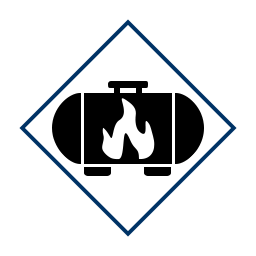 | **Propane/gas risk** | Propane tanks or gas service — keep 10 ft around tanks clear. |
| 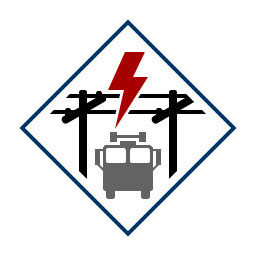 | **Overhead power risk** | Overhead lines crossing access routes or near vegetation. |
|  | **Pets risk** | Pets or livestock on site, for responder and evacuation awareness. |

#### Home ignition zones

| Icon | Name | When to place it |
| --- | --- | --- |
| 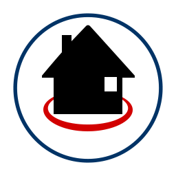 | **HIZ 0–5 ft** | Any other Zone 0 hazard — combustible mulch, plants against walls, items near vents. |
|  | **HIZ 5–30 ft** | Any other Zone 1 hazard — unspaced vegetation, tall grass, woodpiles within 30 ft. |
|  | **HIZ 30–100 ft** | Zone 2 hazards — heavy fuel accumulations, dense stands, or slash within 30–100 ft. |

## Computer vision

On-device inference runs in the browser through two runtimes: the **WUI hazard
detector** (JANUS's 19-class YOLOv8s from BFMA, ONNX via **onnxruntime-web**,
self-hosted wasm in `public/ort/`) and **TensorFlow.js** for the DeepLab
segmentation path (backend order `webgpu → webgl → cpu`, chosen once per
session in `tfBackend.ts`; override with `?tfBackend=` / `localStorage['tf-backend']`).
Models are fetched once and cached — TF.js models in IndexedDB via the
`indexeddb://` scheme, the ONNX model and wasm runtime by the service worker's
`model-cache` — so later loads work offline. Code lives in
`src/features/computer-vision/`.

### Two runtime pipelines

| Pipeline | Entry | Model | Input | Cache |
| -------- | ----- | ----- | ----- | ----- |
| **Still assessment photos** | `useImageAnalysis` (assessment `PhotoCaptureStep`) | WUI detector (findings) **+** DeepLab v3 **ADE20K** (coverage/score/debris) | 640² / 513² | SW `model-cache` / `indexeddb://deeplab-ade20k-q2` |
| **Live AR scan** | `useLiveFrameAnalysis` → `useFrameAnalysisLoop` → `getActiveAnalyzer()` (`ARViewer`) | WUI detector (default; falls back to DeepLab if it can't load) | 640² | SW `model-cache` |

The live loop's analyzer is selectable at runtime for A/B tests:
`?cvModel=wui | deeplab` in the URL, or `localStorage['cv-model']`. Default is
the WUI detector (`frameAnalyzer.ts`). (The YOLO11n-seg COCO plumbing
prototype was removed 2026-09-01: its pretrained Ultralytics weights were
AGPL-3.0 — see `docs/SBOM.md`.)

The WUI detector's classes map to state-localized guideline checklist items
via `detectionGuidance.ts` (assessment content), so captured detections cite
the jurisdiction's actual question and standard. Its accuracy is tracked by a
golden-image evaluation (`npm run eval:detector`) with a recorded per-class
recall baseline.

The DeepLab path produces an ADE20K class map, which `vegetationSegmenter.ts`
turns into `DetectedRisk`s via helpers: `coverageOf`, `hasGroundFuel`,
`vegToStructureProximity`, `classBoundingBoxes`, and `risksFromClassMap` (all
unit-tested against synthetic class maps).

### Hazard taxonomy

The label taxonomy is a single source of truth — `HAZARD_TAGS` in
`src/shared/types/index.ts` — **11 hazard classes** plus a `no-hazards-visible`
negative tag: `dry-dead-vegetation`, `ground-fuels`, `overhanging-vegetation`,
`vegetation-near-structure`, `woodpile-lumber`, `propane-tank`,
`wood-shake-roof`, `roof-debris`, `gutter-debris`, `combustible-fence`,
`combustible-mulch`. Class indices 0–8 are frozen (the last two were appended)
so already-labeled data stays valid. The training scripts parse `HAZARD_TAGS`
directly rather than duplicating the list.

These 11 user-facing *condition* tags coexist with the WUI detector's 19
*object* classes; the plan for unifying them (objects detect, conditions
annotate) is in [`docs/TAXONOMY.md`](docs/TAXONOMY.md) — read it before
merging labeled data or training the next model.

### Training-data & labeling workflow

Custom (YOLO-seg) models are trained out-of-band; the scripts prepare data for
labeling and convert the result back for the browser:

1. **Gather images** into the training pool (`training-data/`):
   - `node scripts/harvest-images.mjs` — scrape commercially-usable
     (CC0 / PDM / CC BY) WUI-hazard photos from Wikimedia Commons + Openverse.
   - `npm run import:photos` — import a local folder of field photos
     (imported as triage `keep`).
   - `npm run export:training` — pull **training-consented** assessment photos
     from Supabase into a YOLO dataset layout (uses `SUPABASE_SERVICE_ROLE_KEY`
     if set, else the anon key).
   - `npm run import:consented` — fold those exported photos into the
     triaged-keep pool so they reach the labeling bundle (idempotent).
   - `npm run flywheel` — the two steps above chained. **Run this on a
     schedule** (e.g. weekly cron on a machine with the service-role key) so
     field photos flow continuously into the labeling queue; consented photos
     still need a PII pass (faces, plates, house numbers) before labeling.
2. `npm run label:prepare` — build a **SAM-assisted** labeling bundle from the
   triaged-keep pool: `classes.txt`, Ultralytics `dataset.yaml`, and a
   Label-Studio PolygonLabels config + tasks (tool-agnostic; also works with
   CVAT / Roboflow).
3. **Label** the instance masks (self-hosted CVAT + GPU SAM in this project's
   setup). `scripts/make-labeling-examples.py` generates the good-vs-loose mask
   example for the labeling guide.
4. **Train** the next hazard detector — training stack and class mapping per
   [`docs/TAXONOMY.md`](docs/TAXONOMY.md) (stack choice pending the Ultralytics
   AGPL determination, `docs/SBOM.md`). The browser deployment contract is
   fixed regardless: ONNX detect head, `imgsz` 640, input `images`
   `[1,3,640,640]`, output `output0` `[1, 4+C, anchors]` — served from
   `/models/` and decoded by `wuiDetector.ts` (update `WUI_CLASSES` /
   `DETECTION_GUIDANCE`, then `npm run eval:detector` must beat the recorded
   baseline).

## Augmented reality

`src/features/augmented-reality/` renders geo-anchored content over the live
camera using three.js. Device pose comes from `useGeoPose` (GPS + compass
heading + pitch/roll); world points are placed via the `geoEnu` bridge
(`geoToEnu` → `enuToThree`).

**Defensible space in AR.** The AR view draws the *same* zone geometry as the
map (`defensibleZones.ts`), so the two can't disagree. Since the map's footprint
lookup needs a rendered map, AR gets the footprint off-map via
`src/shared/utils/buildingFootprint.ts`, which fetches the Mapbox Streets
**vector tile** for the point and decodes its `building` layer
(`@mapbox/vector-tile` + `pbf`) — the Tilequery API can't do this (it returns
only a point, not the outline). Circles are the fallback when no footprint is
found.

Two renderers draw the zones, by platform:

| Path | Component | Platform | Tracking |
| --- | --- | --- | --- |
| Compass overlay | `GeoMarkerOverlay` | **All (incl. iOS)** | GPS + compass (metres, some drift) |
| WebXR | `WebXRScene` | **Android Chrome only** | 6-DoF SLAM (drift-free) |

WebXR `immersive-ar` is unsupported on iOS (all iOS browsers are WebKit), so
iPhone/iPad use the compass overlay; Android additionally gets the WebXR
version. Both project the shared zone polygons onto the ground plane.

**Stability and calibration.** The approach is ported from the shipped BFMA
app. `poseFilters.ts` applies:
- a GPS accuracy gate;
- heading averaging;
- in WebXR, anchors that freeze after the first settle-once north alignment.

On-screen controls let the user correct what sensors get wrong:
- **North ◀/▶** trim (±30°);
- **Center zones here** / **Center zones at reticle**, to re-center the zones
  on the structure;
- **Ground ▲/▼**, a height nudge;
- **Re-align north** (WebXR).

On Android WebXR there are also:
- a hit-tested **tape measure** (ft/m);
- **drop marker at reticle**;
- depth occlusion where the device supports it;
- wayfinding chips that point to a selected marker.

## Auth — DEV_MODE

`src/app/providers/AuthProvider.tsx` has a top-level `DEV_MODE` flag that
bypasses Supabase auth with a mock user. Flip it to `false` to exercise the real
auth flow.

## PWA / offline caching

Configured in `vite.config.ts` via `vite-plugin-pwa` (`registerType:
'autoUpdate'`). Runtime caches:
- Mapbox tiles;
- Supabase responses;
- images;
- models, under `model-cache`: `/ort/` (onnxruntime-web), `/models/`, and
  `.wasm` / `.onnx` / `.tflite` files;
- TF.js model shards, under `tfjs-model-cache`. Because the service worker auto-updates, a new
deploy is picked up on the next reload.

## Service tiers & costs

The live system runs entirely on free tiers today. Limits that matter for
this app, and the cheapest paid step-up for each service (verified against
vendor pricing pages, Aug 2026):

| Service | Free-tier limits (relevant to this app) | Lowest paid tier |
| --- | --- | --- |
| **Supabase** (auth, Postgres, photo storage) | 500 MB database · **1 GB file storage** · 5 GB egress · 50K monthly active users · 500K edge-function invocations · max 2 active projects · **project pauses after 1 week of inactivity** | **Pro, from $25/mo** — 8 GB disk, 100 GB storage, 250 GB egress, 100K MAU, no pausing (overages metered, e.g. $0.09/GB egress) |
| **Cloudflare Workers** (hosting) | 100K requests/day, 10 ms CPU per invocation — but **requests to static assets are free and unlimited**, and this app is deployed as static assets only, so hosting effectively has no usage cost | **Workers Paid, $5/mo** — 10M Worker requests + 30M CPU-ms included; only needed if server-side Worker logic is added |
| **Mapbox** (map, geocoding, AR footprint tiles) | Pay-as-you-go with free monthly allowances — **50K map loads** (GL JS), **100K geocoding requests** (property search), **200K vector-tile requests** (AR building footprints) | No subscription — usage beyond free allowances bills automatically: $5/1,000 map loads, $0.75/1,000 geocodes, $0.25/1,000 tile requests |

Practical implications:

- **Supabase's 1 GB file storage is the first ceiling** — assessment photos
  land in the `assessment-photos` bucket, so a few hundred field photos can
  fill it. The **1-week inactivity pause** also stops auth and sync dead
  until the project is manually restored; a production deployment should
  budget for Pro ($25/mo).
- **Cloudflare costs nothing** for this app as deployed (static assets are
  unmetered on the free plan).
- **Mapbox has no cliff** — it keeps working past the free allowance and
  starts billing the attached card. 50K map loads/month is roughly 1,600
  map-opens a day, far above current usage; the offline tile cache
  (CacheFirst, 30 days) also suppresses repeat tile traffic in the field.

## Documentation

- [`docs/USER_GUIDE.md`](docs/USER_GUIDE.md) — illustrated end-user tutorial (with screenshots) for using the app.
- [`docs/INSPECTION_GUIDELINES.md`](docs/INSPECTION_GUIDELINES.md) — state-by-state record of the guidelines behind the inspection checklist (legal basis, parameters, sources).
- [`docs/TEST_PLAN.md`](docs/TEST_PLAN.md) — end-user test plan covering every feature.
- [`docs/SBOM.md`](docs/SBOM.md) — software bill of materials (dependencies, licenses, external data sources, and the open Ultralytics AGPL flag on the detector weights).
- [`docs/TAXONOMY.md`](docs/TAXONOMY.md) — proposal unifying the detector's 19 object classes with the 11 hazard-condition tags (read before merging labeled data or training).
- [`docs/legend/`](docs/legend/) — map legend key images used above.
- `CLAUDE.md` — architecture guide for contributors.
