# FireRisk — User Guide

A step-by-step walkthrough of how to assess a property's wildfire risk with the
FireRisk app, from signing in to tracking your mitigation work and sharing the
report with your fire agency. Screenshots are taken from the app itself on a
phone-sized screen; the app is designed mobile-first for use out in the field.

> **What you'll accomplish:**
> - create an account;
> - walk a property through a 4-step assessment;
> - read your risk report and track the recommended fixes;
> - send the report to your fire agency;
> - explore the risk map and AR tools.
>
> Fire agency staff should also read
> [For fire agencies & inspectors](#12-for-fire-agencies--inspectors).

## Contents

1. [Getting started](#1-getting-started)
2. [The dashboard](#2-the-dashboard)
3. [Running an assessment](#3-running-an-assessment)
4. [Reading your report](#4-reading-your-report)
5. [Tracking your mitigation work](#5-tracking-your-mitigation-work)
6. [Sharing, PDFs & submitting to an agency](#6-sharing-pdfs--submitting-to-an-agency)
7. [The risk map](#7-the-risk-map)
8. [AR view](#8-ar-view)
9. [Training center](#9-training-center)
10. [Settings](#10-settings)
11. [Working offline](#11-working-offline)
12. [For fire agencies & inspectors](#12-for-fire-agencies--inspectors)

---

## 1. Getting started

FireRisk is a Progressive Web App (PWA). Open it in your phone's browser and, if
prompted, choose **Add to Home Screen** / **Install** to run it full-screen like
a native app.

### Create an account

If you're new, tap **create a new account** on the sign-in screen and fill in
your name, email, and a password (at least 8 characters). Accept the Terms of
Service and Privacy Policy, then tap **Create account**. You're signed in
straight away; there's no confirmation email to wait for.

| Sign in | Create account |
| --- | --- |
| 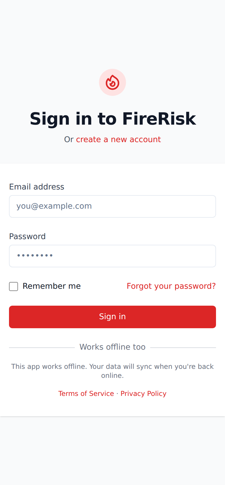 | 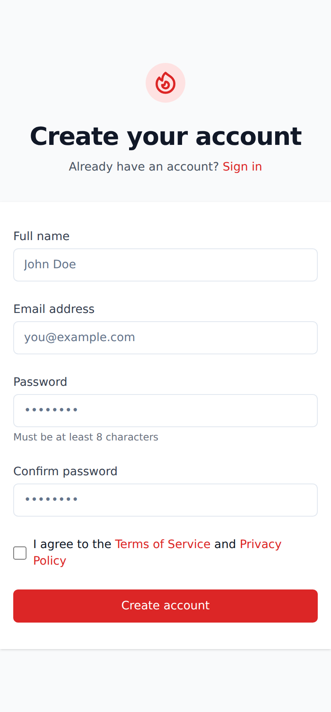 |

> **Works offline.** FireRisk keeps working with no signal. Everything you
> capture is saved on your device and syncs automatically the next time you're
> online. See [Working offline](#11-working-offline).

---

## 2. The dashboard

After signing in you land on the **Dashboard**, your home base. At the top are
three quick actions (**New Assessment**, **View Risk Map**, **Training**),
followed by summary stats (total assessments, completed, average score, and how
many are in progress) and a list of your recent assessments.

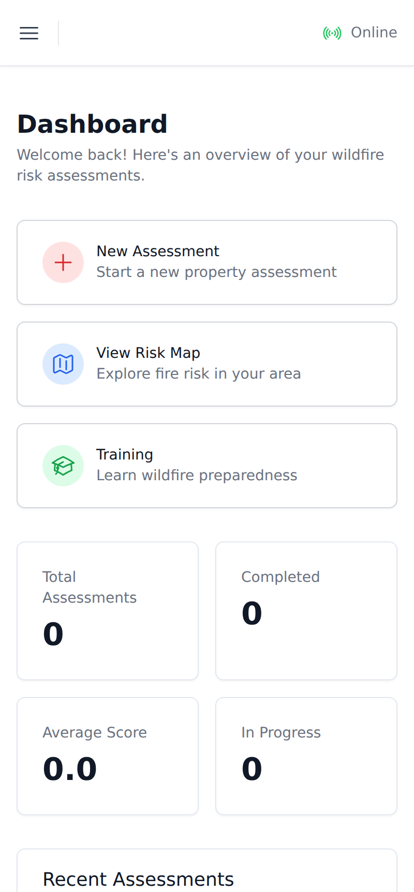

Tap the **☰ menu** in the top-left at any time to jump between Dashboard, New
Assessment, Risk Map, AR View, Training, and Settings. Agency staff also see
**Inspections** (see [section 12](#12-for-fire-agencies--inspectors)).

---

## 3. Running an assessment

This is the core of the app. Tap **New Assessment** to start the 4-step wizard.
The progress bar at the top always shows where you are: **Property Info →
Photo Capture → Inspection → Results**. Use **Next** / **Previous** at the
bottom to move between steps.

### Step 1 — Property info

Enter the **property address** (required). Optionally add the Parcel ID/APN, and
tap **Use Current Location** to attach GPS coordinates. FireRisk works out which
**state** the property is in and uses that state's wildfire guidelines for the
checklist. The step shows which guidelines will apply. When the address is
filled, **Next** turns red and becomes tappable.

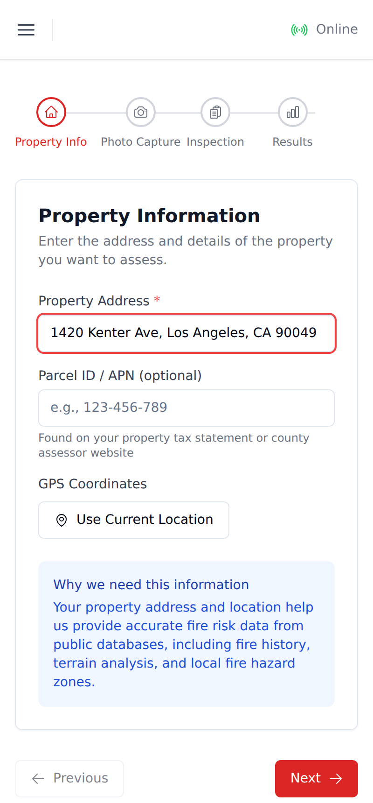

> Adding your location also puts the property on your fire agency's map if you
> later submit the assessment to them.

### Step 2 — Photo capture

Pick a category (**Defensible Space**, **Roof & Structure**, **Vegetation**, or
**Vents & Openings**), then tap **Take Photo** to capture that area of the
property. Each photo is analyzed on your device by the built-in hazard detector,
which flags potential hazards automatically and links them to the matching
checklist question. A count badge shows how many photos you've added per
category.

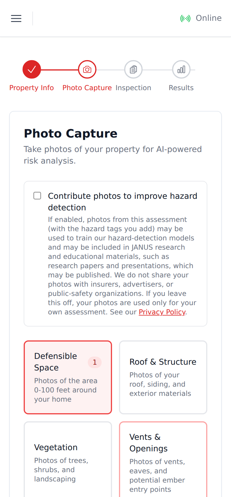

> **Optional:** tick **Contribute photos to improve hazard detection** if you'd
> like your photos to help train the models. Leave it off and your photos are
> used only for your own assessment. Read the disclosure carefully before opting
> in.

### Step 3 — Inspection checklist

Answer a series of **Yes / No** questions grouped by category (Defensible Space,
Roof & Structure, Vegetation, Ember Intrusion, Access & Evacuation, Water
Supply). Many questions cite the standard they're based on (e.g. *CAL FIRE PRC
4291*), and **More info** expands helpful guidance. **About these guidelines**
shows which state's rules apply, their legal standing, and links to the official
sources. The progress bar at the bottom tracks how many you've answered.

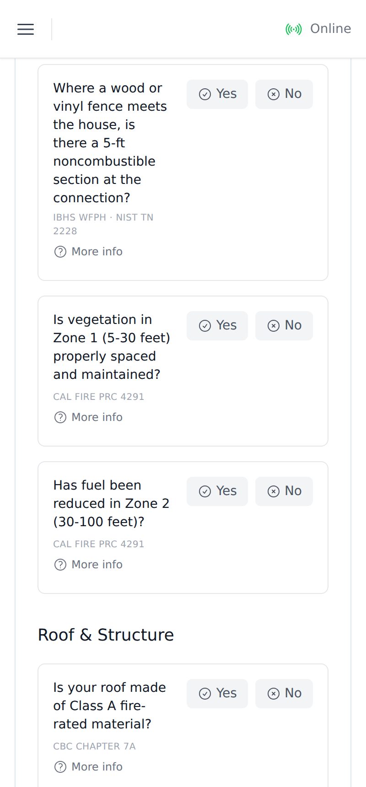

### Step 4 — Results

FireRisk computes an **Overall Risk Score** out of 10, a per-category breakdown,
key findings, and next steps.

> **Higher score = safer.** The score measures how prepared the property is, so
> a higher number means *lower* wildfire risk.

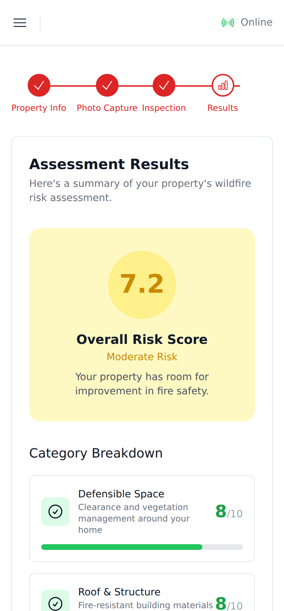

Review everything, then tap **Complete Assessment** to save it. It now appears on
your dashboard and in the property's history.

---

## 4. Reading your report

Opening a saved assessment shows the full report: the address, the overall
score with a risk badge, each category's sub-score, and quick links to **View on
Map** and **AR View**. Below that are your **Findings** and prioritized
**Recommendations**, each tagged *immediate*, *short-term*, or *long-term* with
an estimated cost.

| Score & findings | Recommendations |
| --- | --- |
| 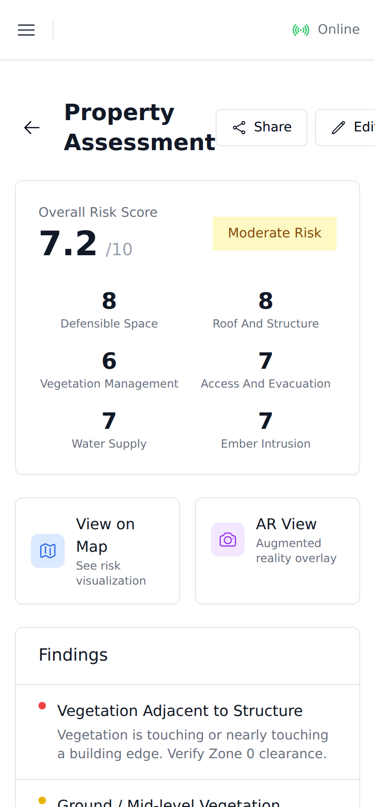 | 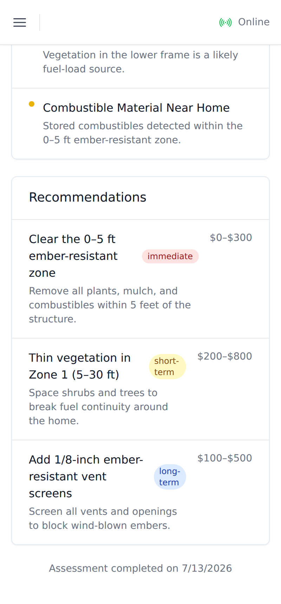 |

The buttons at the top of the report are **Print / Save as PDF**, **Share**,
and **Edit**.

---

## 5. Tracking your mitigation work

Each recommendation in your report doubles as a to-do item. As you work through
them:

1. **Set its status:** **To do → Planned → In progress → Done**. Tapping
   **To do** again resets it.
2. **Add a note**, such as what was done, by whom, and when.
3. **Add a photo** of the finished work as evidence. It's saved on your phone
   and uploads when you're online.

The bar at the top of Recommendations shows how many items are done, and how
many *immediate* items still need attention.

**Verified items.** Once you've submitted your assessment to a fire agency (see
the next section), one of their inspectors can confirm items you've marked
**Done**. A confirmed item shows a green **Verified** badge with the agency's
name, the date and any inspector note. It's then locked, so it can no longer be
changed. Only the agency can verify; you can't verify your own work.

---

## 6. Sharing, PDFs & submitting to an agency

Tap **Share** at the top of the report. The **Link** tab and **Print / Save as
PDF** are for sharing with anyone; the **Agency** tab is for submitting to a fire
agency.

- **Link:** generate a read-only link anyone can open for 30 days, without an
  account. Only someone with the link can see the report.
- **Agency:** submit the assessment to your fire agency:
  1. Choose the agency from the list (agencies in your state appear first).
  2. Tap **Submit to Fire Agency**.

  Only that agency's staff can then see it; it is **not** made public. The
  agency can review it, schedule an inspection, and verify the work you've
  marked Done. Agencies you've submitted to are listed with a **Withdraw**
  button. Withdrawing removes the agency's access.

  > Submit after the assessment has synced; the app tells you to sync first if
  > it hasn't.
- **Print / Save as PDF:** opens your browser's print dialog. Choose **Save as
  PDF** to keep or attach a copy of the report. The PDF includes the score,
  findings, recommendations with their status, notes and photos. It always
  prints in the light theme, even if you use dark mode.

---

## 7. The risk map

The **Risk Map** shows property risk in your area. Switch between **Satellite**,
**Street**, and **Terrain** base maps (top-left), toggle data **Layers** like
Fire History and Slope (top-right), and use the control stack (bottom-right) to
zoom, recenter, find your location, take a screenshot, or share the view.

To inspect a specific home, tap the **🔍 magnifier** to open **Select a
property**, then search an address or **Pick location on the map**.

| Select a property | Defensible-space zones |
| --- | --- |
| 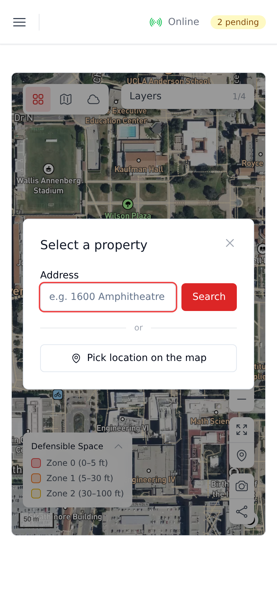 | 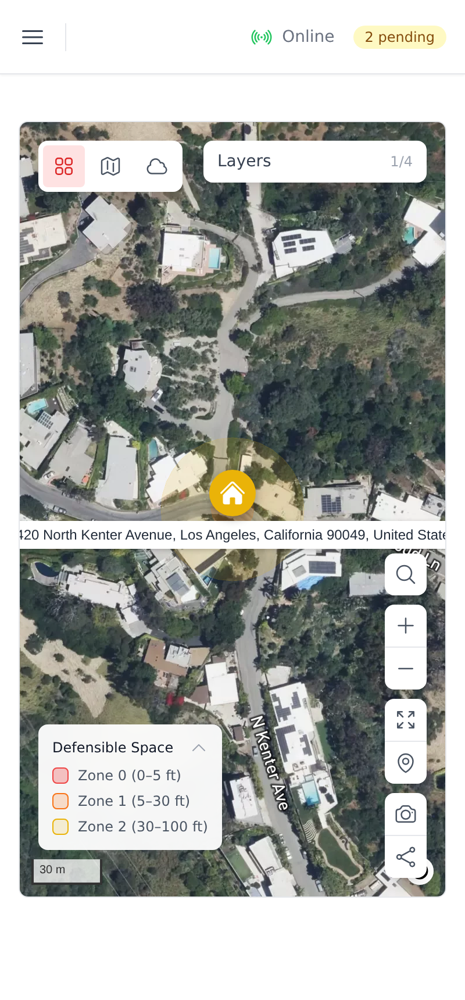 |

Once a property is focused, FireRisk draws the **defensible-space zones** around
it: **Zone 0** (0–5 ft), **Zone 1** (5–30 ft), and **Zone 2** (30–100 ft). Where a
building outline is available the zones trace the footprint; otherwise they fall
back to rings.

When you open the map from an assessment, a strip of **mitigation icons** appears
at the bottom. Tap an icon, then tap the map to mark a hazard (e.g. debris on the
roof, a propane tank, a fire ladder). Tap **?** for what each icon means.

---

## 8. AR view

**AR View** overlays fire-risk information on your phone's live camera while you
walk the property. Use the mode selector (top-left) to switch between:

- **Camera Overlay (Live Scan):** continuously scans the camera feed and marks
  detected hazards. Use the eye button to pause/resume scanning.
- **3D Model View:** shows the defensible-space zones anchored to the ground
  around the structure, with a top-down **radar** that stays accurate even when
  the phone is tilted.
- **Measurement** (Android only): aim the reticle at the ground and tap twice
  to measure a distance in feet or metres. iPhones show a "not available on
  this device" message, because they don't support WebXR.

| Live scan | 3D defensible-space zones |
| --- | --- |
| 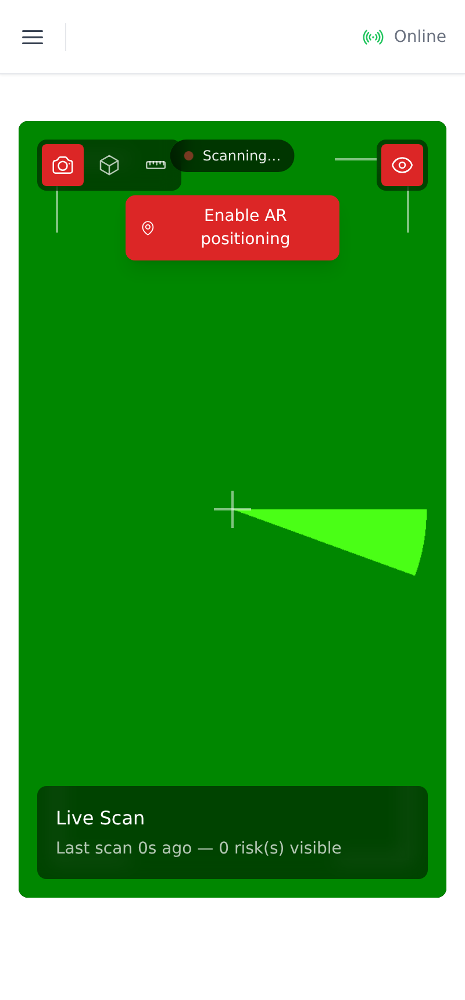 | 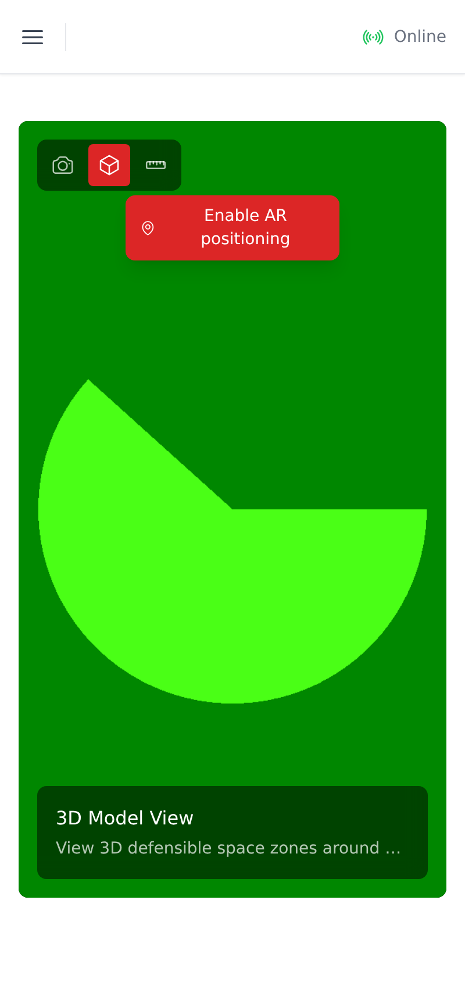 |

**If things look off:** phone compasses and GPS drift, so FireRisk lets you
correct them, and it remembers your settings:

- **North ◀/▶** rotates the overlay until markers line up with what you see.
- **Center zones here** re-centers the zones on where you're standing (walk to
  the house first). On Android you can aim the reticle at the base of the house
  instead.
- **Ground ▲/▼** raises or lowers the zone bands to sit on the ground.
- On Android, **Re-align north** redoes the initial alignment, and you can
  **drop a marker at the reticle** to mark a hazard exactly where you're aiming.
- Tap a marker chip at the bottom to get an arrow pointing to it.

> AR needs camera access and works best outdoors. The green backgrounds above
> are a stand-in for the live camera feed in this documentation; on your device
> the overlays appear on top of the real camera view. Full WebXR tracking is
> Android-only; iPhones use a compass-based overlay.

---

## 9. Training center

The **Training Center** offers short courses on wildfire preparedness. Your
overall progress, lessons completed, and earned badges are shown at the top,
followed by the available courses.

| Course list | Inside a lesson |
| --- | --- |
| 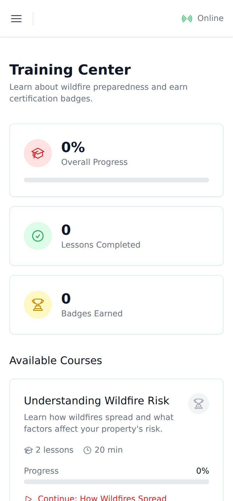 | 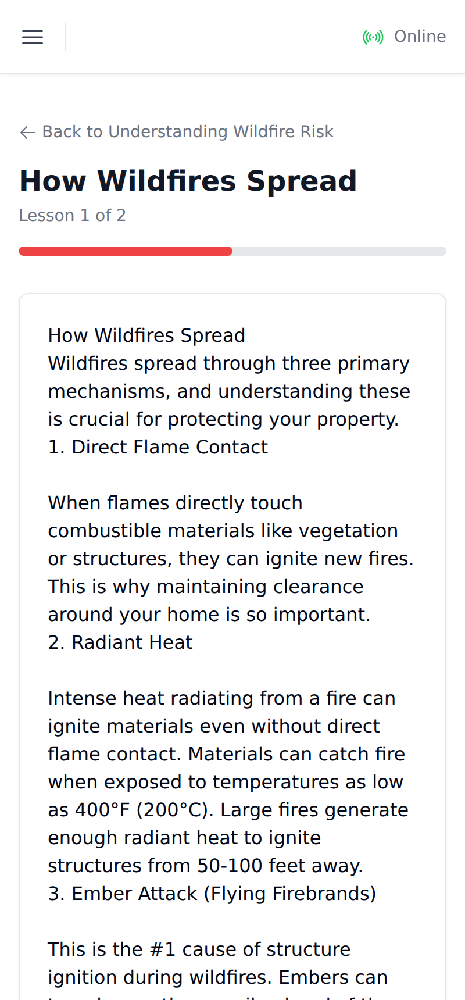 |

Open a course to read its lessons and take the end-of-lesson quiz. Passing a
quiz marks the lesson complete and moves you toward a certification badge.

---

## 10. Settings

In **Settings** you can update your profile, switch the theme between **Light**,
**Dark**, and **System**, toggle notifications, and manage your data, including
**Sync Now**, **Export my data**, and requesting data deletion. **Sign Out** is
at the bottom.

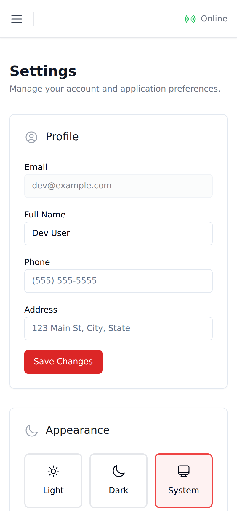

---

## 11. Working offline

FireRisk is built for the field, where signal is often poor:

- Everything you do is saved on your device immediately, even with no
  connection. That covers new assessments, photos, checklist answers, map
  annotations, and mitigation progress (status, notes, evidence photos).
- The top bar shows an **Online / Offline** indicator and a **"N pending"** pill
  when you have changes waiting to upload.
- When you're back online, FireRisk syncs automatically. You can also force it
  from **Settings → Sync Now**.
- **Print / Save as PDF** works offline.

These need a connection:
- creating a share link, and submitting to or withdrawing from an agency;
- everything in the agency **Inspections** dashboard: verifying, status
  changes, exports and the fire check.

So you can walk a property, complete a full assessment offline, and trust that it
will sync the moment you regain a connection.

---

## 12. For fire agencies & inspectors

Agency staff get an **Inspections** item in the menu once their organization has
been set up. Your FireRisk administrator adds organizations and members; you
can't sign yourself up as an inspector. Your role decides what you can do:

| Role | Can |
| --- | --- |
| **Inspector** / **Admin** | Everything below, including verifying work and changing review status |
| **Viewer** | Read the dashboard, reports and exposures; export |

You only ever see assessments homeowners have **submitted to your
organization**.

### The Inspections dashboard

- **Summary tiles:** submitted properties, the share of recommended mitigations
  done, how many are verified, how many are done but awaiting verification, and
  *immediate* items still outstanding.
- **Map:** each property is a dot colored by progress: **red** not started,
  **amber** under way, **blue** all done, **green** all verified. Hover for
  details; click to open the report. Properties without a location are counted
  under the map and listed below.
- **List:** filter by progress or review status. Inspectors and admins move each
  submission through **New → In review → Closed** (and **Reopen**).
- If you belong to more than one organization, pick it at the top.

### Verifying work

Open a property from the dashboard. The report is read-only for you, with a
**Reviewing for &lt;your agency&gt;** label. On any item the homeowner marked
**Done**:

1. Tap **Verify**.
2. Optionally add a note on how it was checked, e.g. "on-site inspection".
3. Tap **Confirm verification**.

The item turns **Verified**, and the homeowner sees your agency's name, the date
and your note. To undo a mistake, use **Revoke verification**; only your agency
can revoke its own verifications. You can't verify items on a property you own.
Verifying needs a connection.

### Exports & reports

The **Export all** buttons always cover every submission, ignoring the filters:

| Export | Contents | Use |
| --- | --- | --- |
| **Properties (CSV)** | One row per property with its progress counts | Grant reporting, spreadsheets |
| **Mitigation actions (CSV)** | One row per recommendation, with status, completed and verified dates, and who verified it | Grant reporting |
| **Map points (GeoJSON)** | Property locations with the same fields | ArcGIS, QGIS |
| **Exposures (CSV)** | One row per property and fire (see below) | Effectiveness reporting |

**Print / Save as PDF** prints the dashboard (tiles, map and list) or any
single report.

### Fire exposure

The **Fire exposure** card checks your submitted properties against this year's
wildfire perimeters from the National Interagency Fire Center (NIFC). Prescribed
burns are excluded.

1. An inspector or admin taps **Check against fire perimeters**.
2. Each property inside a perimeter, or within 1 km of one, is listed with the
   fire's name, discovery date and size.
3. For each, the card records how the property's mitigation stood **when the fire
   was discovered**:
   - items *done* then (as reported by the homeowner);
   - items *verified* then (by an inspector).

That record never changes afterwards, so work marked done after a fire can't
improve it. Run the check after significant fires; results are kept, including
after the current-year data resets in January.
